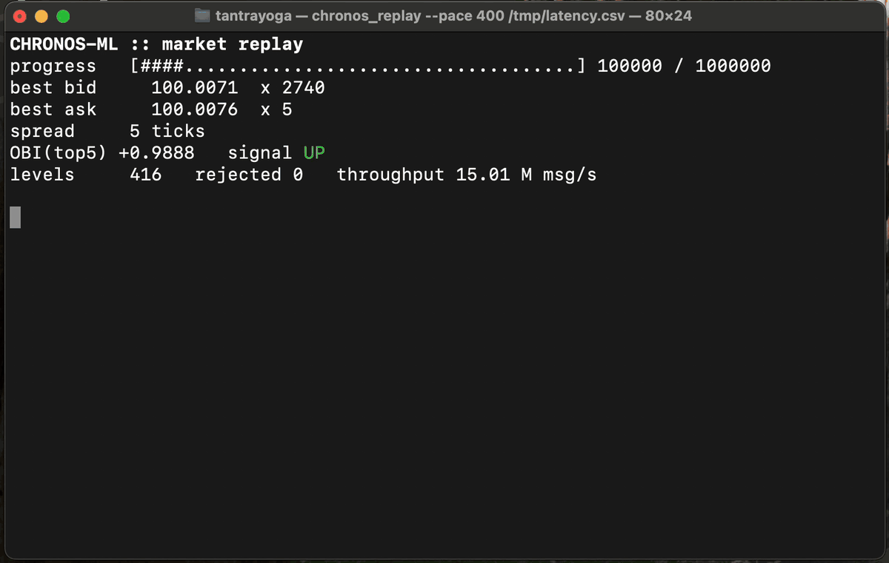
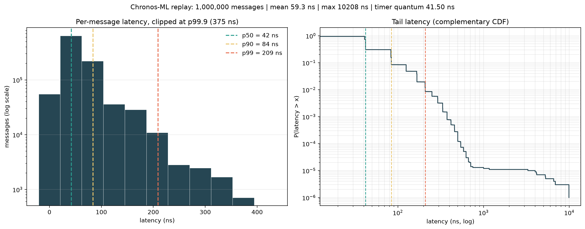
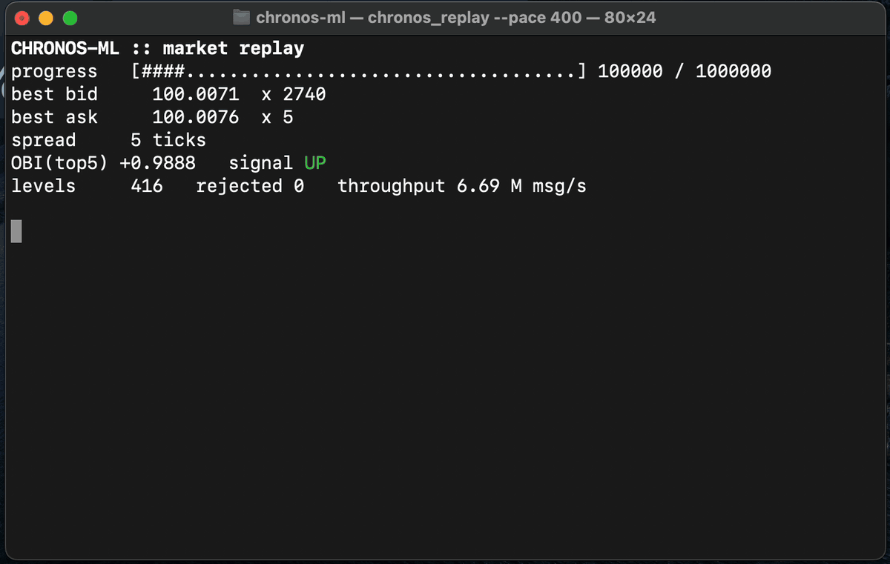

# Chronos-ML

A zero-allocation, low-latency limit order book (LOB) matching engine in C++20, with an inline order-book-imbalance signal, built and measured on Apple Silicon.

On an Apple M4 Pro, the replay harness streams **1,000,000 binary wire messages** from an ingress thread through a lock-free queue into the matching engine at **~15.2M messages/s**, with a per-message latency (decode + match + book update) of **p50 ≈ 42 ns, p99 ≈ 209 ns, p99.9 ≈ 375 ns**. The same engine runs at ~7.1M messages/s on a 2020 M1 and ~6.6M messages/s on a shared UofT AMD EPYC Linux server ([comparison](#cross-hardware-comparison)).



*Live dashboard from `chronos_replay --pace 400`. Pausing slows the replay so it can be watched; the paused time is not counted in throughput or latency.*



*M4 Pro, median-throughput run, first 10% of messages excluded as warmup, with p50 / p90 / p95 / p99 / p99.9 marked.*

---

## Contents

- [System architecture](#system-architecture)
- [Apple Silicon hardware tuning](#apple-silicon-hardware-tuning)
- [Inline ML signal](#inline-ml-signal)
- [Performance benchmarks](#performance-benchmarks)
- [Building, testing, and running](#building-testing-and-running)
- [Limitations and honest caveats](#limitations-and-honest-caveats)

---

## System architecture

```
 raw bytes          SPSCQueue<Packet, 65536>          OrderBook<4096, 1M>
┌──────────┐  push  ┌──────────────────────┐  front  ┌──────────────────────────┐
│ ingress  │ ─────▶ │ head_ │ tail_ │ ring │ ──────▶ │ parse_wire_order (BE→LE) │
│ thread   │        │ (own  │ (own  │      │         │ add_order → match()      │
└──────────┘        │ line) │ line) │      │         │ on_book_state_changed()  │
                    └──────────────────────┘         │   └▶ OBI (NEON) → signal │
                                                     └──────────────────────────┘
```

### Zero-allocation object pool — [`memory_pool.h`](include/chronos/memory_pool.h)

`FixedObjectPool<T, Capacity>` allocates a `std::array<T, Capacity>` once and hands out slots through an index-based free-list stack. `allocate()` and `deallocate()` are O(1) and never touch the heap after construction.

### Cache-sized orders with intrusive queues — [`types.h`](include/chronos/types.h)

`Order` is exactly 40 bytes with natural 8-byte alignment (enforced by `static_assert`), so no order ever straddles a cache line in the flat pool array. Orders link to each other by **32-bit pool index** rather than pointer: each price level's FIFO queue is threaded through `prev_idx`/`next_idx` directly inside the pool, so the order *is* the list node and no separate node allocation exists.

### Flat, sorted price-level array — [`order_book.h`](include/chronos/order_book.h)

All levels live in one `std::array<PriceLevel, MaxPriceLevels>` sorted by `(side, price)`. Buy levels form a contiguous front block and Sell levels a contiguous back block, so the best bid and best ask sit on either side of a single boundary index. Sweeping the book is a linear walk outward from that boundary, which the hardware prefetcher handles well, with no tree rebalancing and no pointer chasing.

Each `PriceLevel` keeps an incrementally maintained `resting_qty`, updated on every append, fill, and cancel, so reading top-N depth for the ML features is O(N) instead of a walk over every resting order.

### Matching engine

`add_order()` → `match()` implements price-time priority: an aggressive order crosses the spread against the best opposite levels, fills FIFO within each level using `std::min(taker_remaining, resting_remaining)` (lowered to a conditional select, not a branch), unlinks fully filled orders back to the pool, and compacts drained levels out of the array. `cancel_order()` uses the same unlink and compaction path.

### Lock-free SPSC queue — [`spsc_queue.h`](include/chronos/spsc_queue.h)

`SPSCQueue<T, Capacity>` decouples ingress from matching:

- **False-sharing isolation:** `head_`, `tail_`, and the storage ring each get their own `alignas(128)` cache line. 128 bytes is the line size both the M4 Pro and M1 report (`hw.cachelinesize`), not the 64 bytes common on x86.
- **Minimal ordering:** each side loads its own index `relaxed`, loads the other side's index `acquire`, and publishes with `release`. There is no `seq_cst` anywhere on the path.
- **Power-of-two masking:** wraparound is `index & (Capacity - 1)`, not `%`.
- **Zero-copy consume:** `front()` / `pop_front()` let the matcher decode a packet in place inside the ring slot.

Verified by a two-thread stress test that moves 1,000,000 sequenced items with zero loss and zero reordering.

### Zero-copy binary protocol — [`binary_parser.h`](include/chronos/binary_parser.h)

`WireOrder` messages use a fixed 22-byte, big-endian layout (ITCH/OUCH style). `parse_wire_order()` extracts each field with fixed-size `std::memcpy`, which avoids both misaligned loads and strict-aliasing UB and compiles to the same load instructions a pointer cast would produce. Byte order is converted with `__builtin_bswap64/32` (a single `REV` instruction on ARM64). `encode_wire_order()` is the exact inverse; a round-trip test pins the format.

### Telemetry — [`telemetry.h`](include/chronos/telemetry.h)

`now_ns()` reads the ARM64 virtual counter (`CNTVCT_EL0`) directly with `mrs`, with no syscall. `LatencyRingBuffer` is a fixed-capacity, single-writer event log recording the T1–T4 lifecycle checkpoints (received → crossed → unlinked → signal emitted) through an optional, null-by-default sink on the book.

---

## Apple Silicon hardware tuning

### Thread QoS and naming — [`thread_utils.h`](include/chronos/thread_utils.h)

macOS has no `sched_setaffinity`, `taskset`, or `isolcpus`. The XNU scheduler keeps thread placement for itself so it can balance P-cores, E-cores, and thermals, and exposes *intent* to applications instead of hard pinning.

| Utility | Mechanism | Result on M4 Pro (macOS 15.5) and M1 (macOS 14.6.1) |
|---|---|---|
| `elevate_thread_qos()` | `pthread_set_qos_class_self_np(QOS_CLASS_USER_INTERACTIVE)` | **Accepted.** The strongest scheduling-priority signal available to user code. |
| `set_thread_name()` | `pthread_setname_np` (calling thread only on macOS) | **Accepted.** Threads appear as `chronos-ingress` / `chronos-matcher` in Instruments and lldb. |
| `set_thread_affinity_tag()` | Mach `thread_policy_set(THREAD_AFFINITY_POLICY)` | **Rejected with `KERN_NOT_SUPPORTED`.** Apple Silicon does not implement affinity tags; the call is kept for Intel Macs and degrades to a no-op. |

So on Apple Silicon, QoS class is the only real placement lever. The engine does not rely on the affinity tag for correctness or for its benchmark numbers.

### ARM NEON SIMD — [`ml_simd.h`](include/chronos/ml_simd.h)

The order book imbalance (OBI) feature is computed with NEON intrinsics. Four price levels of bid and ask volume load into `uint32x4_t` registers (`vld1q_u32`), convert to `float32x4_t` in one instruction (`vcvtq_f32_u32`), and produce four lanes of `bid − ask` and `bid + ask` with one `vsubq_f32` and one `vaddq_f32`. A single horizontal reduction (`vaddvq_f32` → `faddp`) per call collapses the lanes, and the fifth level is handled by a scalar tail. The compiled object contains `ucvtf.4s`, `fsub.4s`, `fadd.4s`, and `faddp` as expected. A 10,000-trial randomized test checks the result against a scalar reference.

---

## Inline ML signal

[`ml_inference.h`](include/chronos/ml_inference.h)

- **Feature:** `OBI = (Σbid − Σask) / (Σbid + Σask)` over the top 5 levels per side, bounded in `[−1, 1]`.
- **Model:** a fixed `constexpr` linear model over `{OBI, spread}`, thresholded into `{Down, Flat, Up}` with arithmetic (`(score > up) − (score < down)`) that lowers to `cset`, not a conditional branch.
- **Wiring:** every book mutation (insert, fill, cancel) calls `on_book_state_changed()`, which recomputes features and runs inference in constant time. With no telemetry sink attached, the hook costs a single null check.

The weights are hand-set placeholders, not a trained model; see [Limitations](#limitations-and-honest-caveats).

---

## Performance benchmarks

The same engine, measured on three environments: two Apple Silicon laptops and a shared UofT CS Linux server.

**Build:** Release (`-O3 -march=native`), compiled natively on each machine. Macs at commit `fc4596a`; Linux at `499663e`, which adds only the Linux build fix (the hot path is identical).

**Method:** 5 unpaced runs of the replay per configuration. Throughput is the median of the 5; percentiles come from run 3's latency file (run 3 was within 3% of the median throughput in every configuration). The Mac tables use every message; the Linux tables drop the first 10% as warmup, which on the M4 Pro left p50 / p90 / p99 / p99.9 unchanged (the cold-start effect lasts only about the first 1,000 messages). The Macs were plugged in, running from an editor terminal with everyday apps open, so these are typical-desktop numbers, not an isolated lab setup.

### End-to-end market replay — [`src/replay_harness.cpp`](src/replay_harness.cpp)

1,000,000 pre-generated, deterministic ITCH-style messages (about 30% aggressive), streamed ingress thread → `SPSCQueue` → matching thread. Latency is measured per message around **decode + `add_order` (match, book update, inference hook)**. It does **not** include the time a message waits in the queue before the matcher picks it up, and dashboard rendering is excluded.

### Cross-hardware comparison

All three run with the OS free to place threads wherever it likes (no pinning).

| Metric | M4 Pro (macOS) | M1 (macOS) | AMD EPYC 74F3 (Linux) |
|---|---|---|---|
| Throughput | **15.2M msg/s** | **7.1M msg/s** | **6.6M msg/s** |
| p50 | 42 ns | 125 ns | 70 ns |
| p90 | 84 ns | 167 ns | 170 ns |
| p99 | 209 ns | 500 ns | 290 ns |
| p99.9 | 375 ns | 875 ns | 460 ns |
| mean | 59 ns | 132 ns | 85 ns |
| max (single worst message) | ~10 µs | ~30 µs | ~28 µs |
| Rejected orders | 0 | 0 | 0 |
| Throughput spread across 5 runs | 12.2–15.3M (first run slower, the rest within 1.3%) | 7.00–7.11M | 5.43–6.74M (first run slower, the rest within 3%) |

| Machine | M4 Pro | M1 | UofT `wolf.teach.cs` |
|---|---|---|---|
| CPU | Apple M4 Pro | Apple M1 | AMD EPYC 74F3 (Zen 3), 2 sockets |
| Cores | 8P + 4E | 4P + 4E | 48 (24 per socket, SMT off) |
| L2 | 16 MB per P-cluster | 12 MB per P-cluster | 512 KB per core |
| L3 | n/a | n/a | 32 MB per chiplet (512 MB total) |
| Cache line (queue padding) | 128 B | 128 B | 64 B |
| Timer used by the engine | 24 MHz counter (~41.7 ns ticks) | 24 MHz counter (~41.7 ns ticks) | `steady_clock` (readings in 10 ns steps) |
| OS | macOS 15.5 | macOS 14.6.1 | Ubuntu 24.04, kernel 6.8 |
| Compiler | Apple clang 17 | Apple clang 15 | GCC 13.3 |
| Other load during the run | everyday apps | everyday apps | shared server: 41 sessions, load average ~5 |

- **M4 Pro vs M1:** the same code runs about 2.1–2.4× faster on the M4 Pro across throughput and the tail. The M1 is also two macOS releases and two Apple clang versions behind, so part of the gap may be the compiler, not the silicon.
- **Linux server vs the Macs:** the EPYC sits between the two laptops. Its p50, p99 and p99.9 are closer to the M4 Pro's, while its p90 and throughput are closer to the M1's. This is a 2021 server part tuned for many parallel cores rather than single-thread speed, it was serving 41 other sessions at the time, and the queue handoff crosses between cores on a two-socket machine.
- **The p50s are not exactly comparable.** The Macs read a 24 MHz hardware counter, so anything under ~42 ns reads as 0 or 42. The Linux build reads `steady_clock`, which has finer steps but costs more to read, and that read cost is part of every Linux sample.



*The same paced replay on the M1 (`--pace 400`). The book state at each checkpoint is identical to the M4 Pro run, because the feed is deterministic; only the timing differs.*

### Thread pinning on Linux

Linux, unlike macOS, lets a user pin a process to specific cores with `taskset`. Same machine, same binary, three placements:

| Placement on `wolf` | Throughput | p50 | p90 | p95 | p99 | p99.9 | max | Throughput spread |
|---|---|---|---|---|---|---|---|---|
| A. unpinned | 6.6M msg/s | 70 ns | 170 ns | 200 ns | 290 ns | 460 ns | 28 µs | 5.43–6.74M |
| B. `taskset -c 1` (both threads share one core) | **10.2M msg/s** | **60 ns** | **90 ns** | 150 ns | **230 ns** | **390 ns** | 133 µs | **9.97–10.20M** |
| C. `taskset -c 2,3` (one core per thread) | 6.8M msg/s | 70 ns | 170 ns | 200 ns | 300 ns | 460 ns | 186 µs | 6.52–7.13M |

- **One shared core was the fastest and most repeatable**, with 1.5× the throughput, a lower tail, and only 2% run-to-run variation. With both threads on one core, each message the ingress thread writes is still in that core's own cache when the matcher reads it. On two cores (A and C), every message's cache line has to move between cores first, and that transfer costs more than the two threads taking turns.
- **That number flatters B.** The benchmark times only how long each message takes to process, not how long it waited in the queue. On a shared core, the matcher can't run while the ingress thread holds the CPU, so messages pile up in the queue. For a live feed, that waiting time is exactly the latency that matters, and this harness doesn't measure it. B's 133 µs worst case is the visible sign: most likely the matcher being paused partway through a message.
- **Pinning to separate cores (C) changed nothing compared with unpinned (A).** `taskset` only restricts where *this* process may run; it doesn't keep other users' work, kernel threads, or interrupts off cores 2 and 3. A truly quiet core needs `isolcpus` / `nohz_full` and moving interrupts elsewhere, all of which need root and weren't available on a shared lab server. So these runs show what pinning does on a busy machine, not what full core isolation would do.

### Component benchmarks — [`tests/test_benchmark.cpp`](tests/test_benchmark.cpp)

| Scenario | M4 Pro | M1 | EPYC 74F3 (Linux) |
|---|---|---|---|
| Resting insert, 10,000 orders across 500 levels | p50 ≈ 42 ns, p99 ≈ 84 ns | p50 ≈ 125 ns, p99 ≈ 167 ns | p50 ≈ 60 ns, p99 ≈ 80 ns |
| Single taker sweeping ~250 levels / 5,000 resting orders (50,000 units) | ≈ 39–40 µs (≈ 8 ns per resting order consumed) | ≈ 99 µs (≈ 20 ns per resting order consumed) | ≈ 65 µs (≈ 13 ns per resting order consumed) |

### Reading the distribution

- **Timer resolution sets the floor.** Both chips' counters run at 24 MHz (`hw.tbfrequency`), so one tick is about 41.67 ns and every sample is a whole number of ticks. The M4 Pro's p50 of 42 ns means "within one tick", and about 5% of its samples read 0 ns (they finished inside a single tick), so its true median is likely somewhat lower. The M1's p50 of 125 ns is three ticks, so the M1's median gap is real, but it is still only resolved to ±1 tick. On Linux the engine reads `steady_clock` instead, whose readings came in 10 ns steps. `plot_latency.py` bins on the detected step to avoid aliasing artifacts.
- **The rare slow outliers come from the OS, not the engine.** The Mac CCDF has a small plateau between roughly 1 and 4 µs, at a frequency of about 10⁻⁵ to 10⁻⁴ depending on the run, and the Linux maxima reach 28–186 µs. The hot path does no allocation and no locking, so these are consistent with scheduler preemption, interrupts, or first-touch page faults landing inside a sample. QoS elevation on macOS and `taskset` on Linux change how often this happens, but neither can eliminate it without full core isolation.

Regenerate the figure yourself:

```sh
./build/src/chronos_replay latency.csv
python3 -m pip install -r scripts/requirements.txt
python3 scripts/plot_latency.py latency.csv -o docs/latency_histogram.png                       # drops first 10% as warmup
python3 scripts/plot_latency.py latency.csv --warmup-fraction 0 -o /tmp/latency_all.png        # keep every message
```

---

## Building, testing, and running

Requires CMake ≥ 3.25 and a C++20 compiler. Catch2 and Google Benchmark are fetched automatically. Tested on macOS (Apple clang 15 and 17, arm64) and Ubuntu 24.04 (GCC 13.3, x86-64). On Linux the NEON path falls back to scalar code and the macOS QoS/affinity calls are no-ops; pin with `taskset` instead.

```sh
cmake -S . -B build -DCMAKE_BUILD_TYPE=Release
cmake --build build -j

./build/tests/chronos_tests        # 39 test cases, ~30k assertions
./build/src/chronos_replay         # 1M-message replay + live terminal dashboard
./build/src/chronos_replay --pace 400   # same, paused 400 ms per frame so it can be watched
```

| Test file | Covers |
|---|---|
| `test_types.cpp`, `test_memory_pool.cpp` | `Order` layout, pool allocate/free semantics |
| `test_order_book.cpp` | FIFO links, level sorting, crossing, partial fills, multi-level sweeps |
| `test_integration.cpp` | T1–T4 telemetry ordering, cancel compaction, null-sink behavior |
| `test_spsc_queue.cpp` | FIFO, wraparound, full/empty, 1M-item two-thread stress |
| `test_threading.cpp` | QoS / naming / affinity applied around a live SPSC pipeline |
| `test_binary_parser.cpp` | Endianness swap, truncation, round-trip encode/parse, routing into the book |
| `test_ml_inference.cpp`, `test_ml_simd.cpp` | OBI bounds, prediction thresholds, NEON vs. scalar equivalence |
| `test_benchmark.cpp` | 10k-order insertion percentiles, deep sweep timing |

---

## Limitations and honest caveats

- **Single instrument, limit orders only.** No IOC/FOK/stop/iceberg order types, no multi-symbol routing, no risk or position checks before matching.
- **No network or persistence layer.** The replay generates bytes in memory; there is no socket I/O, no journaling, and no crash recovery.
- **Cancels from the wire are parsed but not routed.** Resolving a `CancelOrder` message requires an order-id → pool-index map, which is not implemented yet.
- **The model is a placeholder.** The linear weights are hand-set to demonstrate branchless, constant-time inference on the hot path. They are not fit to market data and carry no predictive claim.
- **"Zero allocation" is by construction, not yet by enforcement.** Every hot-path structure is a fixed-size array allocated before the replay starts, but the build does not yet trap stray allocations (for example, with a debug `operator new` override) or run under ThreadSanitizer.
- **Thread affinity is unavailable on Apple Silicon** (see above). Mac results reflect QoS elevation only.
- **Latency excludes queueing delay.** Each sample covers processing one message, not the time it waited in the SPSC queue. This is why sharing one core looks best on Linux in this benchmark, even though it would delay messages on a live feed.
- **No isolated-core measurement.** The Linux runs used a shared lab server without root, so `isolcpus` / `nohz_full` were not available. The pinning results reflect a busy machine, not a dedicated trading host.
