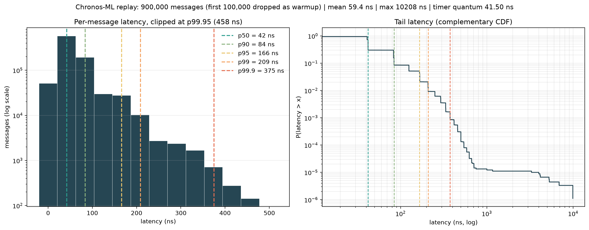

# Chronos-ML: Low-Latency High-Frequency Trading Engine (C++20)


*Live market replay on an Apple M1: 1,000,000 binary orders streamed from an ingest thread through a lock-free SPSC ring buffer into the matching engine, with a branchless order-book-imbalance signal recomputed on every book update. The dashboard is slowed with `--pace 400` so it can be followed; paused time is excluded from the reported 6.84M orders/s.*

---

## Architecture Overview

```
 raw bytes            SPSCQueue<Packet, 65536>            OrderBook<4096, 1M>
┌──────────┐  push   ┌────────────────────────┐  front   ┌───────────────────────────┐
│  ingest  │ ──────▶ │ head_ │ tail_ │  ring  │ ───────▶ │ parse_wire_order (BE→host)│
│  thread  │         │ (own  │ (own  │        │          │ add_order → match()       │
└──────────┘         │ line) │ line) │        │          │ on_book_state_changed()   │
                     └────────────────────────┘          │   └▶ OBI (NEON) → signal  │
                                                         └───────────────────────────┘
```

### Zero-allocation limit order book — [`order_book.h`](include/chronos/order_book.h)

All price levels live in one fixed `std::array`, sorted by `(side, price)`. Bids form a contiguous front block and asks a contiguous back block, so the best bid and best ask sit on either side of a single boundary index: finding a level is a binary search, and sweeping the book is a linear walk the hardware prefetcher handles well. There is no tree to rebalance and no pointer chasing. Each level also keeps a running `resting_qty`, so reading top-of-book depth never walks the order queues.

Matching is price-time priority. An aggressive order crosses the spread level by level, fills resting orders oldest-first using a branch-free `std::min`, returns fully filled orders to the pool, and compacts emptied levels out of the array.

### FixedObjectPool — [`memory_pool.h`](include/chronos/memory_pool.h)

Every `Order` lives in a `FixedObjectPool<Order, N>`: one array allocated at startup, with an index-based free list. `allocate()` and `deallocate()` are O(1) and never call `malloc` or `free` after construction. Each `Order` is exactly 40 bytes with 8-byte alignment (checked by `static_assert`), so no order straddles a cache line. Orders link into their price level's FIFO queue through 32-bit pool indices stored inside the order itself (an intrusive list), so queueing an order allocates nothing.

### Lock-free SPSC ring buffer — [`spsc_queue.h`](include/chronos/spsc_queue.h)

The ingest and matching threads communicate only through `SPSCQueue<T, Capacity>`:

- **No false sharing:** `head_`, `tail_`, and the storage ring each sit on their own cache line (`alignas(128)` on Apple Silicon, 64 bytes elsewhere), so the producer's writes never invalidate the consumer's line and vice versa.
- **Minimal memory ordering:** each side reads its own index `relaxed`, reads the other side's index with `acquire`, and publishes with `release`. There is no `seq_cst` anywhere on the path.
- **No division:** capacity is a power of two, so wraparound is `index & (Capacity - 1)` rather than `%`.
- **Zero-copy consume:** `front()` / `pop_front()` let the matcher decode a packet in place inside the ring slot.

A two-thread stress test moves 1,000,000 sequenced items with no loss and no reordering.

### Zero-copy binary ingestion — [`binary_parser.h`](include/chronos/binary_parser.h)

Orders arrive as fixed 22-byte, big-endian wire messages in the style of ITCH/OUCH. Fields are read with fixed-size `std::memcpy` (no misaligned loads, no strict-aliasing undefined behavior; the compiler emits plain loads) and byte-swapped with `__builtin_bswap`, a single `REV` instruction on ARM64.

### ARM NEON SIMD and branchless inference — [`ml_simd.h`](include/chronos/ml_simd.h), [`ml_inference.h`](include/chronos/ml_inference.h)

- **Feature (NEON):** order book imbalance, `OBI = (Σbid − Σask) / (Σbid + Σask)` over the top 5 levels. Four levels of bid and ask volume load into `float32x4_t` registers, and one `vsubq_f32` plus one `vaddq_f32` handle four levels at once, followed by a single horizontal reduction. A 10,000-trial test checks it against a scalar reference, and non-ARM builds fall back to scalar code automatically.
- **Model (branchless):** a fixed, compile-time linear model over `{OBI, spread}`, thresholded into `{Down, Flat, Up}` as `(score > up) − (score < down)`. That compiles to compare-and-set instructions, so there is no conditional branch for the predictor to miss.
- **Integration:** every insert, fill, and cancel recomputes the features and runs inference in constant time. The weights are hand-set to demonstrate hot-path integration; they are not trained on market data.

---

## Performance Benchmarks



*Apple M4 Pro, 1M-message replay, first 10% excluded as warmup. Left: latency histogram (log scale) with p50 / p90 / p95 / p99 / p99.9 marked. Right: complementary CDF, showing the rare slow events far out in the tail.*

**Baseline (M4 Pro).** The engine processes **~15.2M orders/s** with **p50 ≈ 42 ns, p99 ≈ 209 ns, p99.9 ≈ 375 ns**. The most likely reasons are the M4 Pro's fast cores and its large caches (16 MB of L2 per core cluster), which keep the hottest data, the price-level array and the queue slots in use, close to the CPU. The 42 ns median is also the measurement floor: Apple Silicon's 24 MHz counter ticks every ~41.7 ns, so the true median is likely a little lower.

The spikes start just **past** p99.9. About 1 in 100,000 orders takes 1–10 µs, shown as the flat shelf on the right of the chart. The engine never allocates, locks, or blocks, so these stalls come from macOS pausing the thread (preemption, interrupts, page faults). macOS offers no core isolation: the strongest available lever is the `QOS_CLASS_USER_INTERACTIVE` priority hint, and Apple Silicon rejects Mach thread-affinity requests outright (`KERN_NOT_SUPPORTED`).

**Method.** Release builds (`-O3 -march=native`) compiled natively on each machine; 5 unpaced runs per configuration, median throughput, with percentiles from a representative run. Latency covers decoding plus matching one order. It does not include time spent waiting in the queue. The Macs ran with everyday apps open, so these are typical-desktop numbers, not lab conditions.

### Cross-hardware comparison (no pinning)

| Metric | Apple M4 Pro (macOS 15.5) | Apple M1 (macOS 14.6.1) | AMD EPYC 74F3 (Ubuntu 24.04, shared) |
|---|---|---|---|
| Throughput | **15.2M orders/s** | **7.1M orders/s** | **6.6M orders/s** |
| p50 | 42 ns | 125 ns | 70 ns |
| p90 | 84 ns | 167 ns | 170 ns |
| p99 | 209 ns | 500 ns | 290 ns |
| p99.9 | 375 ns | 875 ns | 460 ns |
| Worst single order | ~10 µs | ~30 µs | ~28 µs |
| Compiler | Apple clang 17 | Apple clang 15 | GCC 13.3 |

The M4 Pro runs the same code 2.1–2.4× faster than the M1 (part of that gap is the M1's older compiler). The EPYC server, a 2021 part built for many parallel cores, was shared with 41 other sessions during the run and lands between the two laptops. The Linux build uses `steady_clock` (10 ns steps) instead of Apple's 24 MHz counter, so the p50s aren't exactly comparable.

### Thread pinning on the Linux server

| Placement | Throughput | p50 | p99 | p99.9 | Worst single order |
|---|---|---|---|---|---|
| Unpinned | 6.6M orders/s | 70 ns | 290 ns | 460 ns | 28 µs |
| `taskset -c 1` (both threads on one core) | 10.2M orders/s | 60 ns | 230 ns | 390 ns | **133 µs** |
| `taskset -c 2,3` (one core per thread) | 6.8M orders/s | 70 ns | 300 ns | 460 ns | **186 µs** |

Pinning did not produce a flat tail. The next section explains why.

---

## Systems Diagnostic: Hardware & OS Jitter

**Setup.** The engine was rebuilt on a shared UofT CS Linux node (`wolf.teach.cs`: 2× AMD EPYC 74F3, 48 cores, 41 active sessions, load average ~5) and run unpinned, pinned with `taskset -c 1`, and pinned with `taskset -c 2,3`.

**Expectation.** Pinning with `taskset` would remove scheduler noise and flatten the tail.

**Result.** It did not. Both pinned configurations kept multi-microsecond outliers, and their worst cases (133 µs and 186 µs) were *worse* than the unpinned run's 28 µs. Four independent causes explain this.

### a) OS scheduling: `taskset` fences the program in, it doesn't fence others out

`taskset -c 1` restricts *this* process to core 1. It does not reserve core 1. The kernel still runs other users' processes, its own housekeeping threads, hardware interrupts (network, disk, timers), and the scheduler's periodic tick on that core. Each of those preempts whichever order is being matched at that moment, and that wait lands inside the latency sample. On a node shared with 41 sessions, this is the dominant source of the outliers.

### b) CPU clock scaling

`lscpu` reported the cores running at about 48% of their maximum frequency. Without the `performance` governor, which requires root, the clock rises and falls with load and power management, so the same code path takes a different amount of time from one moment to the next. That variation spreads the whole distribution, not just the tail.

### c) Dual-thread interference on a shared core

Pinning the ingest (producer) thread and the matching (consumer) thread to the same core forces the OS to time-slice between them. The measurements show this cuts both ways:

- **What it helps:** throughput rose 1.5× and p99 fell. Each packet the producer writes is still in that core's L1/L2 cache when the consumer reads it, so the cross-core cache-line transfers the SPSC queue normally pays for disappear.
- **What it costs:** the matcher can be switched out *partway through* an order, so that order's measured latency includes the other thread's entire time slice. That is the 133 µs worst case. Separately, while the producer holds the core, arriving orders wait in the queue. The benchmark doesn't time that queueing delay, but on a live feed it is real latency, which is why this configuration's better numbers would not carry over to production.

### d) Algorithmic variance

Not every order does the same work:

- **Resting order at an existing price:** a binary search plus an append to the level's queue, the ~40–70 ns common case.
- **Resting order at a new price:** also inserts a level into the sorted array, shifting the entries after it.
- **Aggressive order:** loops over resting orders, and sometimes across several price levels, until it is filled.

This gives a natural spread of roughly **40 ns to 300 ns (p50 to p99)** that has nothing to do with the OS. Even a perfectly isolated core would show this spread. Isolation can only remove the rare, large OS-induced spikes on top of it.

---

## Requirements for True Determinism

A flat, deterministic tail requires owning the hardware. On a dedicated Linux trading host, the standard configuration is:

| Parameter | Level | Effect |
|---|---|---|
| `isolcpus=<cores>` | Kernel boot parameter | Removes the cores from the normal scheduler, so no other task is placed on them |
| `nohz_full=<cores>` | Kernel boot parameter | Stops the scheduler's periodic tick on those cores while a single task runs |
| `irqaffinity=<other cores>` | Kernel boot parameter (plus per-IRQ `smp_affinity`) | Routes hardware interrupts to non-isolated cores |
| `rcu_nocbs=<cores>` | Kernel boot parameter | Moves kernel RCU callback processing off the isolated cores |
| `performance` CPU governor | Runtime (root) | Locks the clock at a fixed frequency, so execution time stops drifting |
| `SCHED_FIFO` | Thread scheduling policy (root or `CAP_SYS_NICE`) | Gives the engine threads real-time priority, so normal tasks cannot preempt them |
| One thread per isolated core | Application design | The producer and consumer never time-slice against each other, so no order is paused mid-match |

Every row except the last needs root access or kernel boot changes, which a shared university node does not allow. None of these settings were measured here; the Linux results above reflect a busy shared machine, not a tuned trading host.

---

## Build & Run

**Requirements:** CMake ≥ 3.25 and a C++20 compiler. Catch2 and Google Benchmark are downloaded automatically on the first configure. Tested on macOS (Apple clang 15 and 17, arm64) and Ubuntu 24.04 (GCC 13.3, x86-64).

```sh
git clone https://github.com/Tantrayoga/chronos-ml.git && cd chronos-ml
cmake -S . -B build -DCMAKE_BUILD_TYPE=Release
cmake --build build -j
```

**Run the tests** (39 test cases, including a 1M-item two-thread queue stress test):

```sh
./build/tests/chronos_tests
```

**Run the market replay** (1M orders, live terminal dashboard, per-order latency written to CSV):

```sh
./build/src/chronos_replay latency.csv               # full speed, for benchmarking
./build/src/chronos_replay --pace 400 latency.csv   # slowed down so the dashboard can be watched
```

Paused time from `--pace` is excluded from the reported throughput and latency, but use unpaced runs for benchmark numbers.

**Plot the latency distribution:**

```sh
python3 -m pip install -r scripts/requirements.txt
python3 scripts/plot_latency.py latency.csv -o latency_histogram.png                       # drops first 10% as warmup
python3 scripts/plot_latency.py latency.csv --warmup-fraction 0 -o latency_all.png         # keeps every order
```

**Pin to cores on Linux** (macOS has no equivalent):

```sh
taskset -c 2,3 ./build/src/chronos_replay latency.csv    # one core per thread
```

On Linux, the NEON code falls back to scalar code and the macOS thread-priority calls do nothing; use `taskset` for core placement instead.
